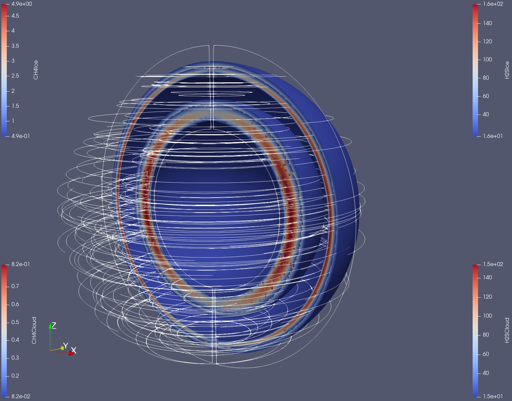
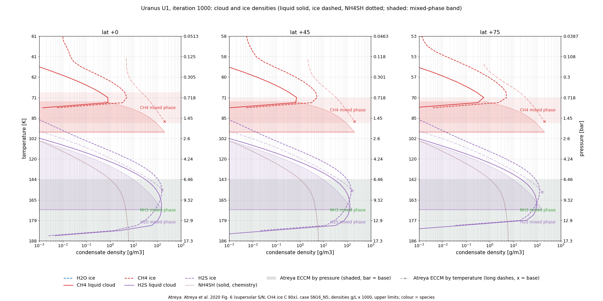

# ATURAN

A 3-D circulation model of **Uranus'** atmosphere with methane and H₂S clouds, chemistry and turbulence -- one of four sibling models of the giant planets.

<p align="center"></p>

<p align="center"><sub>Cloud decks (coloured by density, cut open along a meridian) and wind stream lines (white) after the spin-up; more pictures and the comparison with observed cloud profiles under <i>Cloud profiles vs Atreya</i> below.</sub></p>

**The giant-planet family.** The four models share one numerical core (finite differences on a 41 × 181 × 361 spherical grid, 4th-order Runge-Kutta, a Poisson pressure solver, OpenMP) and 14 byte-identical shared headers (saturation adjustment, precipitation, moist convection, turbulence, radiation, boundary conditions, pressure solver, observed jets, cp(T) and more); each adds its own planet's set-up, chemistry and boundaries. A fix made in one is ported to the others.

| Planet | Model | Atmospheric shell | Cloud decks | What it looks at |
|---|---|---|---|---|
| Jupiter | [ATJUP](https://github.com/RogerGrundmann/ATJUP) | 140 km, ~13 bar to ~0.03 bar | H₂O, NH₄SH, NH₃ | the Great Red Spot: a wake behind a fixed obstacle, or a free vortex |
| Saturn | [ATSAT](https://github.com/RogerGrundmann/ATSAT) | 500 km, ~55 bar to 0.04-0.07 bar | H₂O, NH₄SH, NH₃ | moist convection and the super-rotating equatorial jet; chromophore tracer |
| Uranus | **ATURAN** (this repo) | 225 km, ~17 bar to 0.10-0.14 bar | CH₄, H₂S, NH₄SH, H₂O | the 98° tilt and the equator-to-pole temperature puzzle |
| Neptune | [ATNEPT](https://github.com/RogerGrundmann/ATNEPT) | 200 km, ~32 bar to 0.03-0.05 bar | CH₄, H₂S, NH₄SH, H₂O | the fastest winds in the Solar System, driven by internal heat |

**Sister family:** the same ATOM numerics run the early Earth -- [ATHAD](https://github.com/RogerGrundmann/ATHAD) (steam atmosphere over the magma ocean) → [ATHAD_COND](https://github.com/RogerGrundmann/ATHAD_COND) (CO₂ over a hot sea) → [ATHAD_PERID](https://github.com/RogerGrundmann/ATHAD_PERID) (CO₂ after a peridotitic magma ocean).

Uranus atmospheric general circulation model based on the numerical framework of the [ATOM
climate model](https://github.com/atom-model/ATOM). Solves the 3-D Navier-Stokes equations in a spherical shell extending from
the deep H₂O / NH₃ cloud decks up through the methane condensation layer that gives Uranus
its blue-green appearance. Its precipitation scheme -- the COSMO three-category rain / snow / graupel scheme in the shared `Precipitation.h` -- comes from [ATOM_Precipitation](https://github.com/RogerGrundmann/ATOM_Precipitation), a development version of ATOM.

Uranus is the coldest planetary atmosphere in the Solar System (49 K at the tropopause)
and the only one whose rotation axis lies essentially in the plane of the ecliptic
(97.77° obliquity). One Uranian pole spends 42 Earth-years pointed at the Sun while the
other is in continuous shadow, and yet the observed temperatures at equator and poles
remain remarkably similar — a long-standing puzzle that motivates a 3-D circulation model
with full radiative-convective forcing. Voyager 2's 1986 flyby remains the only in-situ
encounter, so the available constraints are the Voyager temperature/pressure profile,
ground-based and Hubble imagery, and Spitzer/Herschel infrared spectroscopy.

For all relevant data concerning Uranus and its atmosphere the book *Planetary Sciences*
by Imke de Pater and Jack J. Lissauer was indispensable.

---

## Physics & Numerics

- **Domain:** spherical shell, 41 × 181 × 361 grid points (r × θ × φ), ~2.7 million cells
- **Vertical extent:** 225 km atmospheric shell (5.6 km per radial step), 17.3 bar to 0.10-0.14 bar; 360 km before 2026-10-12
- **Dynamics:** finite-difference discretisation of the 3-D Navier-Stokes equations in spherical coordinates
- **Time integration:** 4th-order Runge-Kutta (inner loop) with a Poisson pressure solver (outer loop)
- **Parallelism:** OpenMP shared-memory threading
- **Thermodynamics:**
  - Temperature initialised as a parabolic pole-to-pole profile; reference temperature 76.4 K
  - Equatorial value 60.65 K, polar value 49.15 K — reflecting Uranus's anomalous warm-pole
    equilibrium derived from Voyager 2 IRIS retrievals
  - Boussinesq buoyancy approximation
  - Clausius-Clapeyron / Sanchez-Lavega SVP formulation for saturation vapour pressures
  - Mixed-phase (liquid + ice) saturation adjustment with iterative convergence
- **Microphysics:** two-category ice scheme adapted from the COSMO weather-forecast model
- **Boundary conditions:** zonal-wind templates from QuikSCAT and OSCAR observational
  datasets; temperature/pressure profiles from Voyager 2 (1986) and Hubble Space Telescope
- **Planetary constants:** g = 8.69 m/s², Ω = 1.01 × 10⁻⁴ rad/s (≈ 17.24 h sidereal day),
  reference wind speed 100 m/s

---

## Chemical Species

| Species | Phases modelled | Role on Uranus |
|---------|-----------------|----------------|
| CH₄ | vapour · cloud · ice | Dominant condensable; methane ice-haze deck near the tropopause defines the visible blue-green disc |
| H₂O | vapour · cloud water · cloud ice | Deep tropospheric cloud (~50 bar) |
| NH₃ | vapour · cloud · ice | Mid-troposphere reservoir; sequestered as NH₄SH |
| H₂S | vapour | Required for NH₄SH formation; possibly a dominant volatile in Uranus's deep atmosphere |
| NH₄SH | vapour | Heterogeneous reaction NH₃ + H₂S → NH₄SH at ~230 K |

Methane condensation is the defining cloud process at Uranus's low temperatures and is
fully transported through the chemistry pipeline (RHS, RK4, saturation adjustment,
diffusion mass flux).

### Cloud profiles vs Atreya



Uranus, arm U1 (the defaults of 2026-11-24, `ATURAN_CP_H2` 2 + `_CP_GAS` 1, `satchk/cph2_2026-11-24`) at iteration 1000, against Atreya et al. 2020 Fig. 6 (case SN16_N5, S/N ~10x solar as in the set-up): H2S deck on Atreya's, CH4 cloud base ~1 bar (Atreya ~2.3). Condensate densities against temperature (left axis) and pressure (right axis) at three latitudes; liquid solid, ice dashed, NH4SH dotted; Atreya's ECCM shaded by pressure (bar = base) and as long dashes by temperature (x = base). Made with `python3 -I tools/cloudprofile_pv.py <zonal.vtk> --out <file.png>` (`--atreya <case>|none`, `--lat 0,45,75`); the set for all four giants is in `literature/cloudprofile_compare/` (outside the repo).


Uranus, arm U1 (the defaults of 2026-11-24, `satchk/cph2_2026-11-24`) at iteration 800: CH4 ice / cloud and H2S ice / cloud on the sphere (`<Planet>_sphere_<n>.vts`, shells exaggerated to 1..2 radii), each species as the region above 10 % of its maximum, cut along the 90 / 270 deg meridians, one colour bar per species; white: Velocity stream lines. Made with `python3 -I literature/sphere_screens.py <sphere.vts> <Planet>` (outside the repo). The ice giants' sphere files carry no H2S / CH4 condensate (their writer drops those arrays), so these species are the panorama's wrapped onto the shells (`--pano`).

---

## Repository Layout

```
ATURAN/
├── planet/          # core model (RHS, RK4, thermodynamics, chemistry, I/O)
├── lib/             # array types, config parser, FFT, utilities
├── cli/             # command-line driver (uran)
├── python/          # Cython bindings (pyaturan)
├── uranus/          # run directory (XML config, observational data, output)
│   ├── oscar/       # OSCAR ocean-current dataset (used as zonal-wind template)
│   └── windspeed/   # QuikSCAT surface wind data
├── tinyxml2/        # vendored XML library
├── param.py         # code-generation script (auto-generates parameter files)
└── Makefile
```

---

## Build

**Dependencies:** C++11 compiler with OpenMP support, Python 3, Cython, NumPy.

```bash
# Generate parameter files and build CLI + Python extension
make

# CLI binary only
make uran

# Python extension only
make python

# Clean
make clean
```

The `param.py` script auto-generates several `.inc` / `.pyx` files that parameterise the
model; it runs automatically as part of the build whenever `param.py` itself changes.

### Shared physics headers

Thirteen headers in `planet/` are **byte-identical across ATJUP, ATSAT, ATNEPT and ATURAN**:

```
ATPhys.h  BoundaryConditions.h  ConvectiveAdjustment.h  FluxLimiter.h  JetRef.h  ParaViewWriter.h
Precipitation.h  PressureSolver.h  ProcessDiag.h  Radiation.h  Reporting.h  SaturationAdjustment.h  Turbulence.h
```

There is no submodule and no symlink holding them together — Synology Drive has silently reverted
a working tree once, and a submodule costs friction on every clone. They are plain copies, and
`planet/SHARED.md5` is what makes a divergence loud:

```bash
make check-shared
```

Editing one means: edit it in one repo, copy it to the other three, regenerate its line in **all
four** manifests, and rebuild each.

**`make check-shared` cannot catch everything, and this is the part to read before trusting it.**
It verifies a repo against *its own* manifest, so two repos holding different copies of the same
header both report OK — a state that has already occurred once. The check that does catch it is a
diff between repos, which is why the checksum lines are kept sorted by filename:

```bash
diff ../ATJUP/planet/SHARED.md5 planet/SHARED.md5
```

---

## Optional modules

Every module and experiment is gated by an `ATURAN_*` environment variable, grouped as: radiation (grey two-stream, shared `Radiation.h`), microphysics and turbulence, numerics / experiment knobs, and buoyancy / the hydrostatic split.

The full knob tables (every environment variable with its default and effect, and the notes on them) are in [CLAUDE.md](CLAUDE.md).

---

## Diagnostics

What the model prints at the `checkpoint` cadence (min / max census, column profiles, budgets) and the print-only instruments that can be switched on.

The full text is in [CLAUDE.md](CLAUDE.md).

---

## Usage

### Command-line — note the TWO arguments

```bash
./cli/uran <path> <config file name>
./cli/uran . config_aturan.xml            # config in the current directory
```

A single combined path fails with `couldn't load config file inside cUranusModel`. This is the
reverse of ATOM's `cli/atm`, and the same convention ATSAT and ATNEPT use.

```bash
OMP_NUM_THREADS=12 ./cli/uran . config_aturan.xml > run.log 2>&1
```

Runs in this repository's measurements are single-threaded (`OMP_NUM_THREADS=1`) so that results
are bit-reproducible and byte-comparisons between builds mean something.

**The race was found and fixed. The model's STATE is now reproducible at any thread count.** The
site was `PressureSolverUran.h`'s Poisson loop — Gauss-Seidel written in place, with
`#pragma omp parallel for collapse(2) schedule(dynamic, 4)` over the very two indices its stencil
reads across, so cell `(i,j,k)` was read by the thread owning `(i+1,j)` or `(i,j+1)` while its
owner was writing it. It is now serial; see the comment in that file. Measured at nm=4:

| configuration | 16t run A vs B | 1t vs 16t |
|---|---|---|
| before, `ATURAN_PRESS_SOLVER=0` (default) | differ | differ, 7 of 7 files |
| after, `ATURAN_PRESS_SOLVER=0` (default) | **bit-identical** | **bit-identical** |
| `ATURAN_PRESS_SOLVER=1` (shared red-black) | **bit-identical** | **bit-identical** |

**Nothing was taken back to get this.** One thread ran `collapse(2)` in lexicographic order
already, so the serial loop reproduces the previous 1-thread answer **bit-identically, with not one
differing log line** — every single-threaded measurement in this file still stands. It costs ~0.5 %
of a step: `computePressure` was 0.003 s of a 5.3 s step at 16 threads and is 0.03 s serial.

Two clues that had been recorded, and what they turned out to mean. The whole physics block is
gated on `if(iter_n % 2 == 0)`, which is why *iteration 1 was clean and divergence started at
iteration 2* — the pressure solve does not run on odd iterations. And `p_dyn` feeds the velocity
correction, which is why the first fields to move were `u`, `v`, `w`, `t`. The earlier note that
subset serialisation was weak evidence was right, and it was right for the reason given: the
serialised-subset passes never isolated this loop.

**The log is byte-comparable at any thread count too.** The saturation-adjustment block —
`i_sat`/`j_sat`/`k_sat`, `iter_prec_found`, and the `p_stat`, `T`, `saturation` and per-species
`humid/cloud/ice` values printed with them — was for a while the only thing that still varied.
It is filled under `#pragma omp critical` in `SaturationAdjustmentUran.cpp` and used to record
whichever cell reached the section *last*, so the winner followed thread arrival order. That was
never a race — the section is properly synchronised and writes reporting variables only, and every
output file was bit-identical across it — but it made logs from different thread counts impossible
to diff.

The winner is now chosen by **position** instead: the loop nest is `k`, then `j`, then `i`, so
serial traversal visits `key = (k·jm + j)·im + i` in increasing order and "the last cell found
wins" is exactly "the largest key wins". Taking the maximum reproduces the single-threaded answer
at any thread count. **Which cell is reported did not change** — at 1 thread the log is unchanged
line for line; at 16 threads it now matches it, and two 16-thread runs match each other. This is a
determinism fix, not a change of what the diagnostic means.

`-fsanitize=thread` was run and is **not** what found this. GCC's `libgomp` is uninstrumented, so
TSan sees no happens-before at an OpenMP fork or join and reports every value written before a
region and read inside it: 30 reports, all of that shape, all artifacts. It is also too slow to be
practical at this grid — still inside `init_velocities` after 10 minutes against 45 s uninstrumented
for the whole 4-iteration run. On this toolchain the byte-comparison above is the sharper
instrument; TSan would need clang plus an annotated OpenMP runtime (Archer) to be worth rerunning.

- With every `#pragma omp` disabled: 13 of 13 identical run-to-run **and** identical to the
  1-thread reference. So the cause was OpenMP, not uninitialised memory.
- `RungeKutta_Uran_Turb.cpp` states its acceptance test as "reproducibility at any thread count".
  The RK stages passed it in isolation; the program now passes it too.

Threading is also a poor trade here. Per time step, 1/2/4/8/16 threads give 8.562/5.876/4.467/
4.320/4.220 s — saturating at **2×**, implying ~46 % of a step is serial. Running N jobs
concurrently at one thread each beats running them sequentially at 16 threads for any N ≥ 3.

### Python

```python
import sys
sys.path.insert(0, "uranus")
import pyaturan

model = pyaturan.UranusModel()
model.load_config("uranus/config_aturan.xml")
model.run()
```

Output is written as VTK / VTS files for visualisation in ParaView (panorama, sphere,
radial, zonal, and longitudinal cross-sections).

---

## Known limitations

The photosphere is too warm (unopposed vertical transport, not a heating excess), what `ATURAN_RAD_COUPLING` can and cannot move, the thermal-massflux instrument, the temperature floor reached in real runs, radiation the one module without feedback by default, the fixed thread race, the corrected metric radius, the Jupiter-calibrated grey opacity and the HYDRO_SPLIT default (items 1-10, measured from 2026-10-12 on).

The full text is in [CLAUDE.md](CLAUDE.md).

---

## Author

Roger Grundmann — roger.grundmann@web.de
